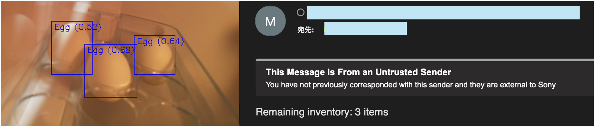
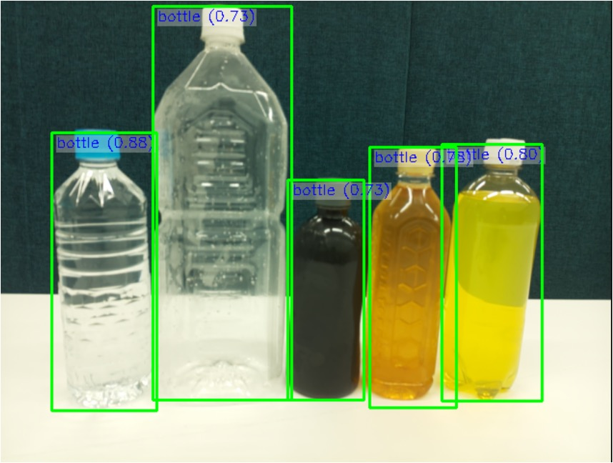
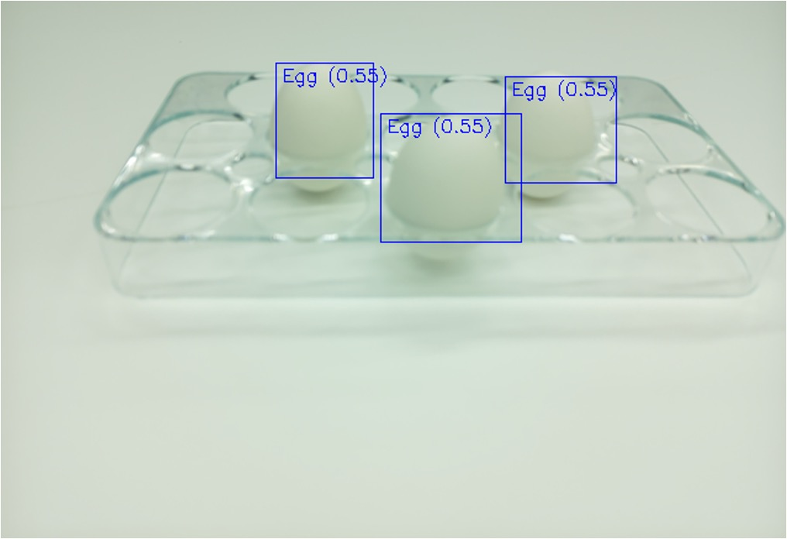
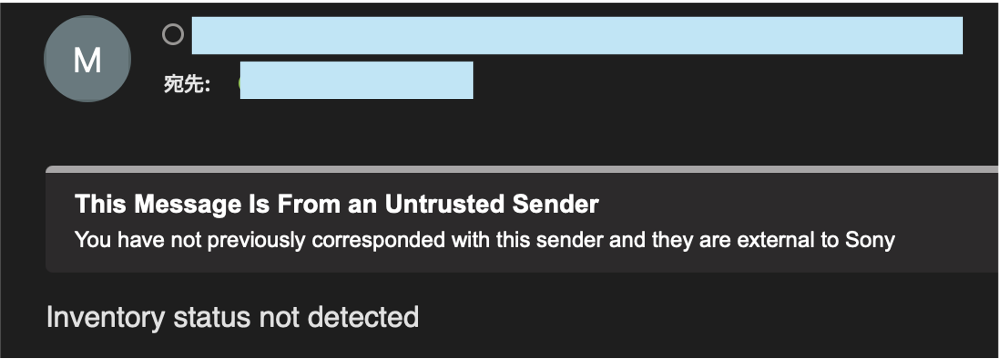

# OutofStock detection system with Object detection
## Overview
This example contains a refrigerator inventory management system with object detection of RaspberryPi AI Camera. This system will send regular email updates with inventory information.



This application uses two types of AI models.

1. **Open Source Software model**
   
    This model is publicly released by the RaspberryPi foundation.

2. **BrainBuilder model**
   
   This model is created using BrainBuilder. BrainBuilder is an AI model development tool without requiring specialized AI knowledge. For more details about BrainBuilder, please visit the [BrainBuilder official website](https://developer.aitrios.sony-semicon.com/en/studio/brain-builder).

## Required equipment list

|    |  Item  |  Required  |  Notes  |
| ---- | ---- | ---- | ---- |
|  1  |  Raspberry Pi AI Camera  |  *  |  Purchase link available [here](https://www.raspberrypi.com/products/ai-camera/)  |
|  2  |  Raspberry Pi  |  *  | This sample uses Raspberry Pi 5. Compatible Raspberry Pi models for AI Camera can be found [here](https://www.raspberrypi.com/documentation/accessories/ai-camera.html#prerequisites)  |
|  3  |  miniUSB Cable  |  *  | For power supply  |
|  4  |  Micro SD Card  |  *  | 32GB or larger recommended  |
|  5  |  Mobile Battery  |  *  | For power supply  |
|  6  |  Mouse  |    | Only if needed  |
|  7  |  Monitor  |    | Only if needed  |
|  8  |  Keyboard  |    | Only if needed  |
|  9  |  HDMI Cable  |    | Only if needed  |

## Installation

```bash
git clone https://github.com/SonySemiconductorSolutions/aitrios-rpi-sandbox.git
cd aitrios-rpi-sandbox/examples/outofstock-detection
```
## Create AI model using BrainBuilder
Please refer to the [BrainBuilder get started guide](https://developer.aitrios.sony-semicon.com/en/studio/get-started-guide?version=2024-12-12&progLang=) 

## Usage
### OSS_model

1. Move to `OSS_model` folder
    ```bash
    cd src/OSS_model
    ```

2. Modify the values of the following variables in `app.py` according to your environment
   
   **Email setting**
   - `delivery_time` : Regular email delivery time
   - `sender` : Sender's email address (gmail)
   - `password` : App password for gmail
   - `receiver` : Recipient's email address
  
   **System setting**
   - `detection_label` : Label name of objects to be detected (Label name can be selected from 80 types of objects used in the COCO dataset)
   - `num_frames` : Number of frames used for detection
   - `img_threshold` : Threshold value for determining door open/close status 

3. Start AI Camera Application
    ```bash
    python app.py
    ```

    **Note:** You can use `app_debug.py` instead of `app.py`. This code provides notifications each time the refrigerator door is opened or closed. It has been prepared for debugging purposes. Please use as needed.

### BrainBuilder_model

1. Move to `BrainBuilder_model` folder
    ```bash
    cd src/BrainBuilder_model
    ```

2. Modify the values of the following variables in `app.py` according to your environment
   
   
   **Email setting**
   - `delivery_time` : Regular email delivery time
   - `sender` : Sender's email address (gmail)
   - `password` : App password for gmail
   - `receiver` : Recipient's email address
  
   **System setting**
   - `detection_label` : Label name of objects to be detected (Make it the same as BrainBuilder label name)
   - `num_frames` : Number of frames used for detection
   - `img_threshold` : Threshold value for determining door open/close status 

3. Place the `label.txt` created with BrainBuilder and the `network.rpk` after package processing in the current folder. Please refer to [BrainBuilder webpage](https://developer.aitrios.sony-semicon.com/en/studio/get-started-guide?version=2024-12-12&progLang=#_deploy_on_raspberry_pi_ai_camera_3) for the packaging method of AI models created with BrainBuilder.

4. Start AI Camera Application
    ```bash
    python app.py
    ```

    **Note:** You can use `app_debug.py` instead of `app.py`. This code provides notifications each time the refrigerator door is opened or closed. It has been prepared for debugging purposes. Please use as needed.

## Expected Results
### Object detection results
If detection accuracy is low, please adjust the `threshold` value as follows.

```python
python app.py --threshold 0.5 
```

**OSS model**
- `detection_label` : `bottle`



**BrainBuilder_model**
- `detection_label` : `Egg`



### Email notification results
You can freely change the email subject and body. If you want to change it, modify the `subject` and `body` in the `send_email` function.

**Case1: Undetected**



**Case2: 3 items are detected**


**Case3: 0 items are detected**

