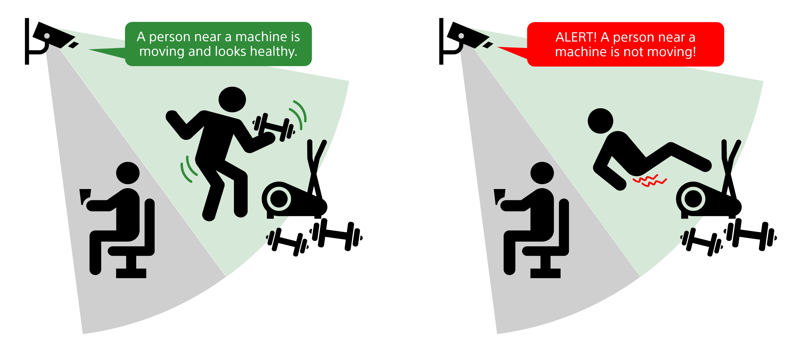

# Unwell Person Detection Application
This application detects unwell individuals in a sport gym environment using the Raspberry Pi AI Camera.



## Prerequisites

- A Raspberry Pi equipped with the [Raspberry Pi AI Camera](https://www.raspberrypi.com/products/ai-camera/)
- Python 3 installed on the Raspberry Pi
- Install UV: Follow the installation instructions provided in the [UV documentation](https://docs.astral.sh/uv/getting-started/installation/) to set it up.
Verify your uv installation by running:

    ```
    uv --version
    ```

## Usage
**1. Navigate to the example directory:**
```bash
cd /home/pi/aitrios-rpi-sandbox-dev/examples/unwell-person-detection
```

**2. Use UV to start the application to install the pyproject.toml and start the application:**
```bash
uv run app.py
```

**3. Access the web interface in your browser at:**  
   `http://<your_raspberrypi_ip>:5000/`
